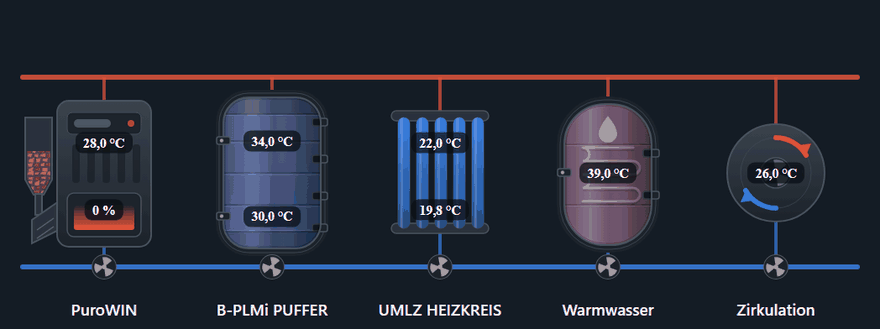
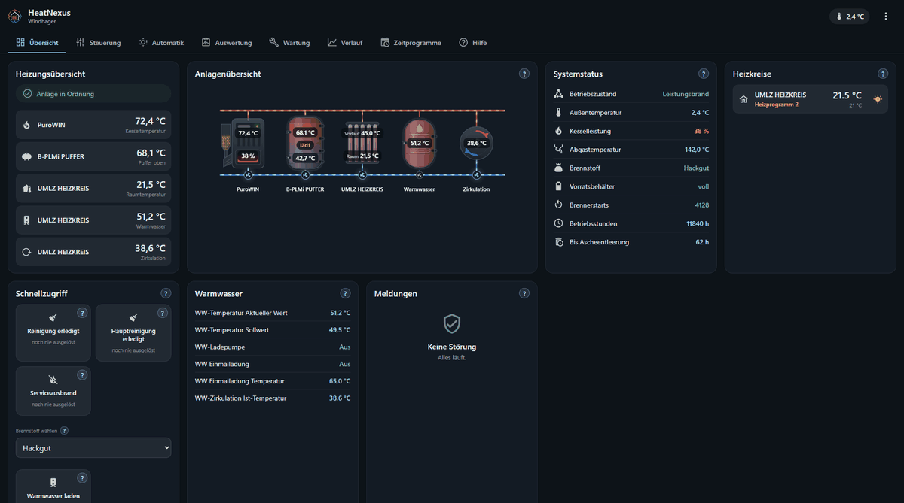

    

[Deutsch](README.md) · **English**

# HeatNexus

Windhager heating systems in Home Assistant — local, complete, no cloud.

HeatNexus reads the system through InfoWIN Touch or InfoWIN Plus on your own
network and creates every datapoint the controller provides: boiler, heat pump,
buffer tank, heating circuits, domestic hot water and circulation. Its own page
in the sidebar shows the system as a diagram.

 

## Features

- **Automatic discovery** of every function of the system, with ranges and options from the device.
- **Own panel** with diagram, system status, controls, maintenance, history and time programmes.
- **Plant diagram** built from the discovered parts, also as a card for your own dashboards.
- **Heat pump and hybrid**: AeroWIN and hybrid manager with power, COP, SG Ready and cost comparison.
- **Thermostat per heating circuit** with a timed override, as in the Windhager app.
- **Automation per heating circuit**: heating pause on mild days, setback in sunshine, learned house model.
- **Care and flue gas**: the analysis shows care dates and reports when the flue gas gets warmer since cleaning.
- **Faults in plain text** with remedies, plus the message list of the control panel.
- **System state per controller** as a sensor for notifications.
- **Dashboard and seven automation blueprints** built from what the system provides.
- **German, English and Dutch** in the panel, datapoints and fault texts.

## Supported Windhager devices

You need a control panel with a network connection on your own network. Open
`http://<system IP>` in a browser. If the web interface appears, you are set.

| | Device | Type | Status |
|:-:|---|---|---|
| 📟 | **InfoWIN Touch** | Control panel with touchscreen | 🟢 tested |
| 📟 | **InfoWIN Plus** | Control panel with buttons | 🔵 in use by users |
| 🔥 | **PuroWIN** | Wood chips, pellets | 🟢 tested |
| 🔥 | **BioWIN**, BioWIN 2, BioWIN 2 Deluxe, PelletsWIN | Pellets | 🔵 in use by users |
| 🔥 | **LogWIN** Klassik and Premium, VarioWIN | Log wood | 🔵 in use by users |
| 🔥 | **DuoWIN** | Pellets and log wood | 🔵 in use by users |
| 🌀 | **AeroWIN** Klassik, Premium, Deluxe | Heat pump | 🔵 in use by users |
| 🔀 | **BioWIN Hybrid** | Hybrid manager for BioWIN and AeroWIN | 🔵 in use by users |
| 🧩 | **UML/UMLZ**, B-PLMi, ZSP | Heating circuit, buffer charging, pumps and relays | 🟢 tested |
| 🧩 | **Infinity PLUS**, Infinity PLUS Wall, buffer at the boiler | Heating circuit, hot water, buffer | 🔵 in use by users |
| 🔥 | **BioWIN Alpha** | Pellets | ⚪ no feedback yet |
| 🔥 | **MinoWIN**, MultiWIN 2 Plus | Gas condensing | ⚪ no feedback yet |
| 🧩 | **Solar ES**, cascade, changeover, IO5500 | Solar, several boilers, energy meters | ⚪ no feedback yet |
| ➕ | Other heat pumps, gas and oil boilers, electric heating | | ⚪ no feedback yet |

🟢 tested in daily operation on the developer's system · 🔵 in use by users,
feedback received · ⚪ described in the database, no feedback yet. Devices not
listed are discovered as well; details on the
[project site](https://xicetea.github.io/HeatNexus/#anlagen).

## Installation

1. Search for **HeatNexus** under *Settings → Marketplace* and download it.
   Up to Home Assistant 2026.10 the catalog is called HACS; restart Home Assistant afterwards.
2. Add the **HeatNexus** integration under *Settings → Devices & services*.
   Home Assistant usually offers the controller as discovered.
3. Account `USER`, factory password `123`. If it was changed, see
   [Passwort herausfinden](https://xicetea.github.io/HeatNexus/ANLEITUNG#passwort-herausfinden) (German).

The first run reads the whole system and takes up to two minutes. Without the
Marketplace or HACS: copy `custom_components/heatnexus` from the
[release](https://github.com/xIceTea/HeatNexus/releases/latest) into your
configuration folder.

## Documentation

Everything else is in the **[guide](https://xicetea.github.io/HeatNexus/ANLEITUNG)**
(German only; the integration itself speaks German, English and Dutch):

[Setup](https://xicetea.github.io/HeatNexus/ANLEITUNG#einrichtung) ·
[Panel](https://xicetea.github.io/HeatNexus/ANLEITUNG#oberflaeche) ·
[Automation](https://xicetea.github.io/HeatNexus/ANLEITUNG#automatik) ·
[Diagram card](https://xicetea.github.io/HeatNexus/ANLEITUNG#karte) ·
[Blueprints and services](https://xicetea.github.io/HeatNexus/ANLEITUNG#vorlagen) ·
[Troubleshooting](https://xicetea.github.io/HeatNexus/ANLEITUNG#fehlersuche) ·
[Datapoints](https://xicetea.github.io/HeatNexus/ANLEITUNG#datenpunkte) ·
[Changes](CHANGELOG.md)

## Contributing

Bug reports with a diagnostics export help most, especially from systems still
listed without feedback. Questions belong in the
[discussions](https://github.com/xIceTea/HeatNexus/discussions); tools and tests
are described in [`tools/README.md`](tools/README.md).

HeatNexus writes to a heating system. Service and factory parameters are off by
default. Use at your own risk.

## License

[GPL-3.0](LICENSE). Name and logo are excluded, see [`NOTICE`](NOTICE).
