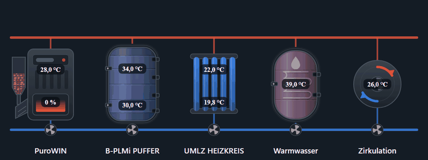
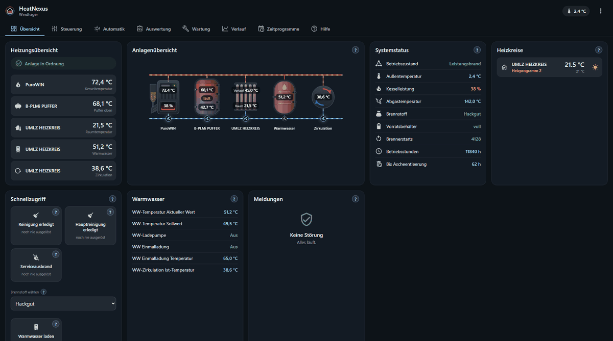

    

**Deutsch** · [English](README.en.md)

# HeatNexus

Windhager Heizungen in Home Assistant – lokal, vollständig, ohne Cloud.

HeatNexus liest die Anlage über InfoWIN Touch oder InfoWIN Plus im eigenen Netz und legt
jeden Datenpunkt an, den die Steuerung führt: Kessel, Wärmepumpe, Puffer,
Heizkreise, Warmwasser und Zirkulation. Eine eigene Seite in der Seitenleiste
zeigt die Anlage als Schaubild.

 

## Funktionen

- **Automatische Erkennung** aller Funktionen der Anlage, mit Wertebereichen und Auswahlwerten vom Gerät.
- **Eigene Oberfläche** mit Schaubild, Systemstatus, Steuerung, Wartung, Verlauf und Zeitprogrammen.
- **Anlagenschaubild** aus den erkannten Teilen, auch als Karte für eigene Dashboards.
- **Wärmepumpe und Hybrid**: AeroWIN und Hybridmanager mit Leistung, COP, SG Ready und Kostenvergleich.
- **Thermostat je Heizkreis** mit befristeter Vorgabe, wie in der Windhager-App.
- **Automatik je Heizkreis**: Heizpause an milden Tagen, Absenkung bei Sonne, gelerntes Hausmodell.
- **Pflege, Abgas, Brennstoff und Wärmepumpe**: Die Auswertung zeigt Pflegetermine, meldet wärmeres Abgas seit der Reinigung und sagt, bis wann der Brennstoff reicht. An der Wärmepumpe vergleicht sie den Gütegrad mit dem Stand nach der Verdampferreinigung.
- **Störungen im Klartext** mit Abhilfe, dazu die Meldungsliste des Bediengeräts.
- **Anlagenzustand je Steuerung** als Sensor für Benachrichtigungen.
- **Dashboard und sieben Automations-Vorlagen** entstehen aus dem, was die Anlage liefert.
- **Deutsch, Englisch und Niederländisch** in Oberfläche, Datenpunkten und Störungstexten.

## Unterstützte Windhager-Geräte

Voraussetzung ist ein Bediengerät mit Netzwerkanschluss im eigenen Netz. Öffne
`http://<IP der Anlage>` im Browser. Erscheint die Weboberfläche, passt es.

| | Gerät | Art | Stand |
|:-:|---|---|---|
| 📟 | **InfoWIN Touch** | Bediengerät mit Touchscreen | 🟢 geprüft |
| 📟 | **InfoWIN Plus** | Bediengerät mit Tasten | 🔵 bei Nutzern im Einsatz |
| 🔥 | **PuroWIN** | Hackgut, Pellets | 🟢 geprüft |
| 🔥 | **BioWIN**, BioWIN 2, BioWIN 2 Deluxe, PelletsWIN | Pellets | 🔵 bei Nutzern im Einsatz |
| 🔥 | **LogWIN** Klassik und Premium, VarioWIN | Scheitholz | 🔵 bei Nutzern im Einsatz |
| 🔥 | **DuoWIN** | Pellets und Scheitholz | 🔵 bei Nutzern im Einsatz |
| 🌀 | **AeroWIN** Klassik, Premium, Deluxe | Wärmepumpe | 🔵 bei Nutzern im Einsatz |
| 🔀 | **BioWIN Hybrid** | Hybridmanager für BioWIN und AeroWIN | 🔵 bei Nutzern im Einsatz |
| 🧩 | **UML/UMLZ**, B-PLMi, ZSP | Heizkreis, Pufferladung, Pumpen und Relais | 🟢 geprüft |
| 🧩 | **Infinity PLUS**, Infinity PLUS Wall, Puffer am Kessel | Heizkreis, Warmwasser, Puffer | 🔵 bei Nutzern im Einsatz |
| 🔥 | **BioWIN Alpha** | Pellets | ⚪ ohne Rückmeldung |
| 🔥 | **MinoWIN**, MultiWIN 2 Plus | Gas-Brennwert | ⚪ ohne Rückmeldung |
| 🧩 | **Solar ES**, Kaskade, Umschaltung, IO5500 | Solar, mehrere Kessel, Energiezähler | ⚪ ohne Rückmeldung |
| ➕ | Andere Wärmepumpen, Gas- und Ölkessel, E-Heizung | | ⚪ ohne Rückmeldung |

🟢 an der Entwickleranlage im täglichen Betrieb geprüft · 🔵 bei Nutzern im
Einsatz, Rückmeldungen liegen vor · ⚪ in der Datenbank beschrieben, noch ohne
Rückmeldung. Auch Geräte, die hier fehlen, werden erkannt; Details auf
der [Projektseite](https://xicetea.github.io/HeatNexus/#anlagen).

## Installation

1. Unter *Einstellungen → Marketplace* nach **HeatNexus** suchen und herunterladen.
   Bis Home Assistant 2026.10 heißt der Katalog HACS; danach Home Assistant neu starten.
2. Unter *Einstellungen → Geräte & Dienste* die Integration **HeatNexus** hinzufügen.
   Meist bietet Home Assistant die Steuerung schon als gefunden an.
3. Zugang `USER`, Passwort ab Werk `123`. Ist es geändert, hilft
   [Passwort herausfinden](https://xicetea.github.io/HeatNexus/ANLEITUNG#passwort-herausfinden).

Der erste Durchlauf liest die ganze Anlage ein und dauert bis zu zwei Minuten.
Ohne Marketplace oder HACS: `custom_components/heatnexus` aus dem
[Release](https://github.com/xIceTea/HeatNexus/releases/latest) in den
Konfigurationsordner kopieren.

## Dokumentation

Alles Weitere steht in der **[Anleitung](https://xicetea.github.io/HeatNexus/ANLEITUNG)**:

[Einrichtung](https://xicetea.github.io/HeatNexus/ANLEITUNG#einrichtung) ·
[Oberfläche](https://xicetea.github.io/HeatNexus/ANLEITUNG#oberflaeche) ·
[Automatik](https://xicetea.github.io/HeatNexus/ANLEITUNG#automatik) ·
[Schaubild als Karte](https://xicetea.github.io/HeatNexus/ANLEITUNG#karte) ·
[Vorlagen und Dienste](https://xicetea.github.io/HeatNexus/ANLEITUNG#vorlagen) ·
[Fehlersuche](https://xicetea.github.io/HeatNexus/ANLEITUNG#fehlersuche) ·
[Datenpunkte](https://xicetea.github.io/HeatNexus/ANLEITUNG#datenpunkte) ·
[Änderungen](CHANGELOG.md)

## Mitmachen

Fehlerberichte mit Diagnose-Export helfen am meisten, besonders von Anlagen,
die oben noch ohne Rückmeldung stehen. Fragen gehören in die
[Diskussionen](https://github.com/xIceTea/HeatNexus/discussions), Werkzeuge
und Tests stehen in [`tools/README.md`](tools/README.md).

HeatNexus schreibt auf eine Heizungsanlage. Service- und Werksparameter sind ab
Werk abgeschaltet. Die Nutzung erfolgt auf eigene Verantwortung.

## Lizenz

[GPL-3.0](LICENSE). Name und Logo sind ausgenommen, siehe [`NOTICE`](NOTICE).
